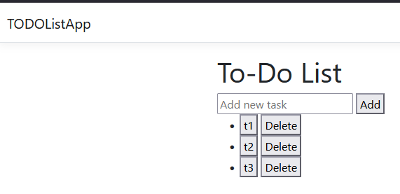
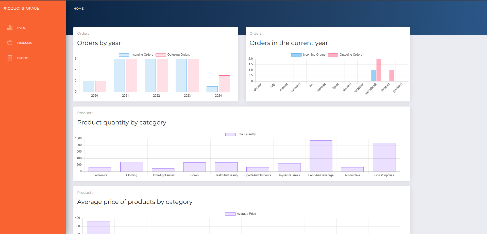
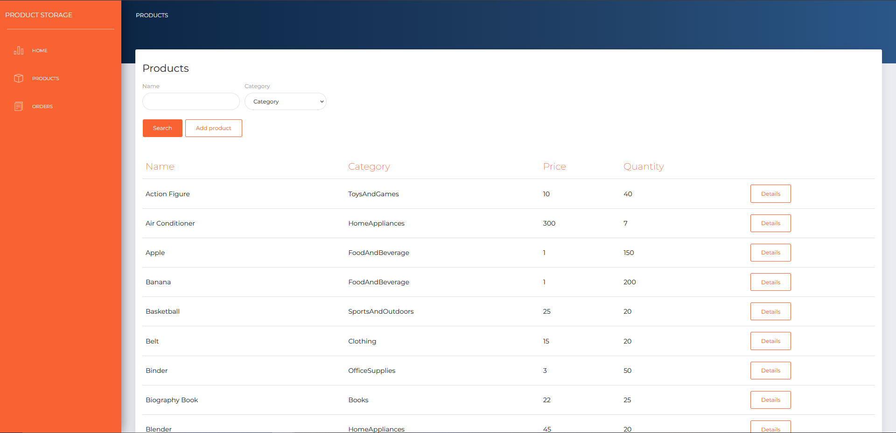
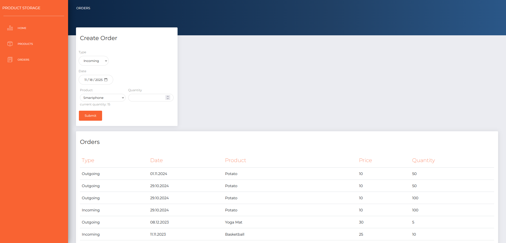
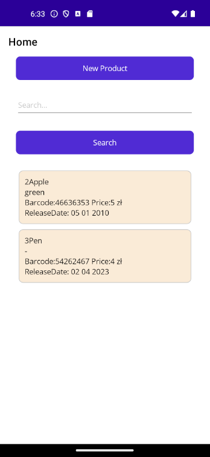
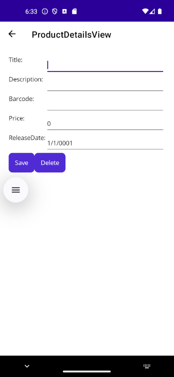
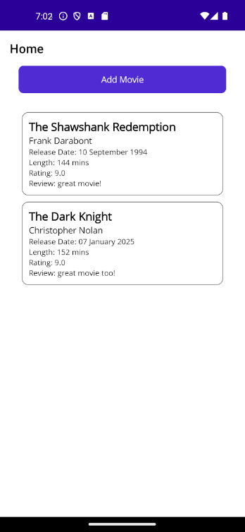
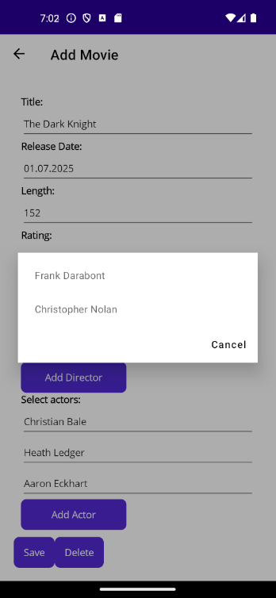

Zbiór miniprojektów na zajęcia "Programowanie aplikacji mobilnych i webowych".

# L1

Prosta aplikacja webowa wykorzystująca .NET 

# L2

3 proste aplikacje webowe .NET. Jedną z nich jest prosty to-do list.

# L3 

Aplikacja webowa .NET w tematyce magazynu produktów. Wykorzystuje gotowy css dla wyglądu aplikacji - Now Ui Dashboard. Wykorzystuje pliki JSON do przechowywania danych.

# L4

Prosta aplikacja mobilna CRUD stworzona w .NET i wykorzystująca MAUI. Wykorzystuje pliki JSON do przechowywania danych.

# L5 

"Movie Reviewer" - Aplikacja mobilna CRUD stworzona w .NET i wykorzystująca MAUI. Składa się z aplikacji frontend MAUI i aplikacji backend udostępniającej API. Wykorzystuje bazę danych MS SQL do przechowywania danych. Baza danych była stworzona w podejściu Code-First, a migracje a modelu danych do bazy danych przeprowadzane są za pomocą narzędzia DOTNET EF.

